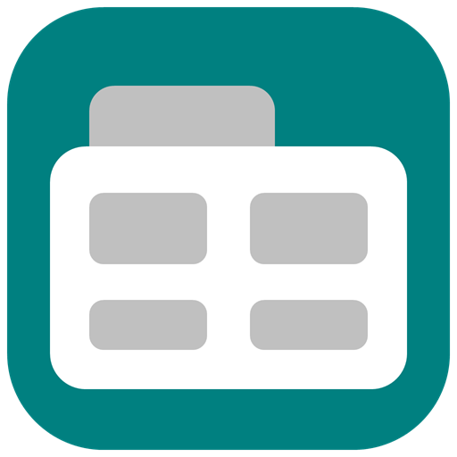
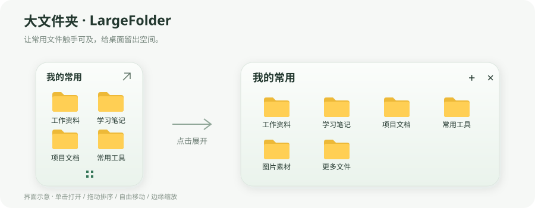

# 大文件夹 · LargeFolder

像手机的大文件夹一样整理 Windows 桌面：把常用文件、文件夹和快捷方式放在一个小卡片里，随手打开，需要时再展开。

[下载便携版](https://github.com/zcyyyc/largeFolder/releases/latest) · [使用说明](使用说明.txt) · [更新记录](CHANGELOG.md) · [反馈问题](https://github.com/zcyyyc/largeFolder/issues)



## 特点

- **小卡片直接打开**：显示真实系统图标和文件名，单击即可访问。
- **展开查看全部**：点击标题、右上角箭头或底部四宫格图标，查看完整分组。
- **自由摆放**：拖动标题或空白处移动卡片，拖动边缘和四角调整大小，自动保存位置与尺寸。
- **自定顺序**：展开后拖动项目排序；收起预览也沿用相同顺序。
- **半透明配色**：柔和的半透明底色，支持调色盘与 RGB 选色；深色背景自动使用浅色文字。
- **真正整理桌面**：桌面快捷方式拖入后默认收纳，应用本身不移动；按住 Ctrl 拖入可只添加入口。普通文件和文件夹也可通过“整理桌面”主动收纳。
- **多分组与搜索**：分组重命名、自定义调色盘与 RGB 选色、组内搜索、托盘控制、可选置顶和开机启动。
- **轻量便携**：C# / WPF 原生窗口，无第三方运行库、NuGet 包或联网服务。

## 下载与运行

1. 到 [Releases](https://github.com/zcyyyc/largeFolder/releases) 下载 `LargeFolder-v1.1.0-windows-portable.zip`。
2. 解压到自己有写入权限的固定文件夹。
3. 双击 `LargeFolder.exe`，把常用项目拖入卡片。

适用于 Windows；需要 .NET Framework 4.x。当前版本在 Windows 11、.NET Framework 4.8 环境验证。无需安装 .NET SDK，也不需要管理员权限。仓库的 **Source code** 压缩包是源码，直接使用请下载名称带 `windows-portable` 的附件。

## 基本操作

| 操作 | 方式 |
| --- | --- |
| 打开项目 | 小卡片单击；展开视图双击 |
| 查看完整分组 | 点击标题、右上角箭头或底部四宫格 |
| 移动卡片 | 按住标题或空白处拖动 |
| 调整大小 | 拖动边缘或四角；两种视图分别保存尺寸 |
| 取消本次移动或缩放 | 拖动时按 `Esc` |
| 调整项目顺序 | 展开后拖动图标，绿色竖线表示插入位置 |
| 恢复默认尺寸 | 卡片右键菜单 → 恢复默认大小 |
| 自定义分组颜色 | 卡片右键菜单 → 分组颜色 → 自定义颜色 |
| 搜索 | `Ctrl+F`，只搜索当前分组项目名称 |
| 收起 | `Esc`，或点击展开视图右上角关闭按钮 |
| 添加项目 / 新建分组 / 重命名 | `Ctrl+O` / `Ctrl+N` / `F2` |
| 找回隐藏卡片 | 双击托盘图标，或再次运行程序 |

卡片放大后会显示更多直接入口；放不下时，底部出现四宫格按钮。悬停项目可查看完整名称和路径。

## 文件到底存在哪里？

普通文件和文件夹默认**添加入口**，只保存路径，原文件仍在原位置。桌面上的 `.lnk` / `.url` 快捷方式默认**收纳到分组**，原桌面图标随之移走，应用本身不移动；按住 `Ctrl` 拖入或选择“仅添加入口”，则保留桌面图标。

**整理桌面**默认勾选“移动所选项目到分组”；选择项目后点击“移入分组”即可真正腾出桌面空间。原件将移动到应用所在文件夹的 `storage/<分组编号>/`。右键已收纳项目可还原；原位置有同名项目时不会覆盖。

```text
LargeFolder.exe
LargeFolder.exe.config
data/                       # 首次运行自动生成，本地设置与恢复记录
  config.json
  config.json.bak
  move-journal.jsonl
storage/                    # 主动收纳的真实原件
```

备份或移动应用时，请一并保留 `data` 和 `storage`。卸载前先还原收纳的原件，再退出程序。程序不联网、不上传文件、不自动收纳桌面，也不默认开启开机启动。

## 从源码构建

在 Windows PowerShell 中进入仓库目录，先关闭正在运行的应用，然后执行：

```powershell
git clone https://github.com/zcyyyc/largeFolder.git
cd largeFolder
powershell -NoProfile -ExecutionPolicy Bypass -File .\build.ps1
.\LargeFolder.exe
```

构建脚本调用 Windows .NET Framework 自带的 `csc.exe`，源码使用 C# 5 / .NET Framework 4 API。可以使用现有 .NET Framework 4.8，无需联网安装 NuGet 依赖。

生成便携包：

```powershell
powershell -NoProfile -ExecutionPolicy Bypass -File .\package.ps1
```

输出位于 `dist/`，包含 ZIP 和 SHA-256 校验文件；打包采用文件允许清单，不包含本地配置、收纳原件或测试数据。

## 测试

```powershell
powershell -NoProfile -ExecutionPolicy Bypass -File .\tests\run-tests.ps1
powershell -NoProfile -ExecutionPolicy Bypass -File .\tests\run-ordering-tests.ps1
powershell -NoProfile -ExecutionPolicy Bypass -File .\tests\run-geometry-tests.ps1
```

覆盖配置恢复、文件收纳与还原、持久移动日志、拖动排序、八方向缩放和独立尺寸保存。测试仅操作新建的独立沙盒；文件测试的第二个沙盒位于系统临时目录。两处沙盒位于不同卷时，才构成真实跨卷验证。测试数据保留供检查，不操作真实桌面文件。

## 项目结构

```text
src/                         # WPF 窗口、系统图标、存储与排序逻辑
tests/                       # 独立 C# 测试及 PowerShell 入口
docs/                        # 文档插图
.github/                     # Windows 构建检查与问题模板
build.ps1                    # 本地离线构建
package.ps1                  # 便携版打包
```

## 当前限制

- 这是独立桌面窗口，尚未嵌入 Explorer 桌面层；“显示桌面”可能隐藏卡片，可从托盘找回。
- 当前版本主要在单屏环境验证，多屏和混合 DPI 的实机覆盖有限。
- 移动日志用于异常中断后核对路径，不会自动重放或合并文件夹。跨卷移动中断时，应先核对源位置与收纳位置。
- 首版便携 EXE 未做代码签名。

## 反馈与贡献

欢迎通过 [Issues](https://github.com/zcyyyc/largeFolder/issues) 提交问题和建议，或发起 Pull Request。反馈时请描述系统版本、操作步骤和预期行为；截图和日志中请遮盖个人文件名、路径及其他隐私信息。

## 许可证

[MIT License](LICENSE) · Copyright © 2026 [zcyyyc](https://github.com/zcyyyc)

---

**English:** A lightweight, portable Windows desktop folder widget built with C# and WPF. Group files, folders and shortcuts, open items from compact cards, drag to reorder, and resize or move cards freely. Local-only storage; no network service required.
